## {.hero-slide}

::: {.kicker}
Julia for HPC / SC26 / 02
:::

::: {.hero}
From tasks to<br>[supercomputers.]{.accent}
:::

::: {.subtitle}
One tiled algorithm.<br>CPU threads, GPUs, and MPI with Dagger.jl.
:::

::: {.byline}
Julian Samaroo · 60 minutes · Live code + hands-on
:::

::: {.notes}
Welcome. This follows Julia and parallel, portable GPU programming. The goal is to describe data
dependencies once and keep the algorithm as we change execution targets.
Keep the terminal and Julia sessions warm before the audience arrives.
:::

## From GPU kernels to a whole application

::: {.eyebrow}
Building on the previous session
:::

::: {.cards}
::: {.card}
<h3>You have GPU work</h3>
Portable kernels and device-aware operations.
:::
::: {.card}
<h3>Now connect the work</h3>
Dependencies, mutable data, and tiled algorithms.
:::
::: {.card}
<h3>Then choose placement</h3>
CPU threads, multiple GPUs, and MPI ranks.
:::
:::

::: {.takeaway}
Dagger coordinates tasks and data around operations that can run on each device.
:::

::: {.notes}
Use the previous GPU section as shared context. Ask what happens when a GPU
operation needs another operation's output, or when there is more than one GPU.
Avoid reteaching GPU kernels. This section moves up to application orchestration;
device-compatible functions and supported library operations remain necessary.
Keep this bridge within the opening three minutes.
:::

## Your next hour

::: {.cards}
::: {.card}
::: {.number}
01
:::
<h3>Build the model</h3>
Tasks, data access, tiles.<br>First 20 minutes.
:::
::: {.card}
::: {.number}
02
:::
<h3>Scale the same code</h3>
GPU scopes and MPI.<br>Next 10 minutes, with the exercise brief.
:::
::: {.card}
::: {.number}
03
:::
<h3>Make it yours</h3>
Parallel tiled Cholesky.<br>30 minutes of hands-on work.
:::
:::

::: {.takeaway}
Success = correct results on each target, plus a plot you can explain.
:::

::: {.notes}
0:00–3:00, including the next slide. All commands are run from 02-Parallel-Programming/Dagger/.
Confirm the chosen access schedule. With rotated Odo access, attendees obtain
allocations only in their assigned windows and start CPU work locally.
This deck supports the demos; switch to the terminal often.
:::

## You describe work. Dagger places it.

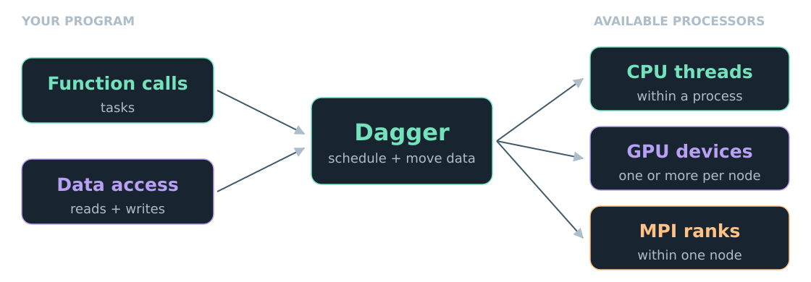{.diagram .full-diagram fig-alt="Tasks with data dependencies flow through Dagger's scheduler to CPU threads, GPU devices, and MPI ranks."}

::: {.takeaway}
The dependency graph exposes what can happen at the same time.
:::

::: {.notes}
Explain the division of responsibility: calls and data access in the program;
placement, dependency enforcement, and movement in the runtime. Placement is
constrained by available processors and scopes. It does not guarantee a speedup.
:::

## A task result is also a dependency

:::: {.columns}
::: {.column width="58%"}
```julia
using Dagger

a = Dagger.@spawn rand(2000, 2000)
b = Dagger.@spawn rand(2000, 2000)
c = Dagger.@spawn a * b
d = Dagger.@spawn sum(c)

fetch(d)
```
:::
::: {.column width="38%"}
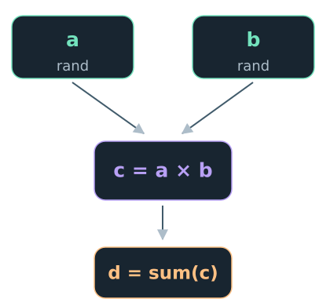{.diagram fig-alt="Independent random-matrix tasks a and b feed matrix multiplication c, which feeds sum d."}
:::
::::

::: {.takeaway}
Pass task handles onward. Fetch the final answer when you need it.
:::

::: {.notes}
3:00–6:00. a and b are independent. c waits for both. d waits for c.
Spawn returns a handle promptly. No manual wait is needed between these calls.
Ask: which two tasks could overlap? Use the graph rather than terminology.
:::

## Open your compute-node REPL

::: {.small}
In an Odo login terminal, with the course repository already cloned:
:::

```bash
cd /gpfs/wolf2/olcf/trn047/scratch/$USER
cd julia-hpc-tutorial-sc26/02-Parallel-Programming/Dagger
export SC26_NODES=1
bash frontier/allocate.sh  # skip if already in your allocation
bash frontier/repl.sh
```

::: {.takeaway}
Wait for <code>julia&gt;</code>. You are now running Julia on a compute node.<br>
Keep this session open for the demos.
:::

::: {.small}
<code>allocate.sh</code> installs dependencies on the login node before requesting a node.
:::

::: {.notes}
At 6:00, before the first demo. The checkout location matches the repository's
Odo access instructions; adjust the first cd if you cloned elsewhere.
Clone the repository before class. allocate.sh runs prepare.sh on the login
node before calling salloc, so missing packages and lazy artifacts are downloaded
and Cray MPI preferences are configured before entering the allocation shell.
Odo's allocation shell runs on a compute node, without package-server access.
The REPL launchers do not download packages and set Julia's package manager offline.
Package compilation takes place on the compute node. Instructors should still
prepare and precompile the environment before class to avoid startup delays.
Obtain the one-node allocation in advance where possible. Skip allocate.sh if
already in that allocation shell, and skip repl.sh if Julia is already open.
The launcher selects the tutorial project and CPU threads on the compute node.
Keep this transition and the following demo within the 6:00–8:00 slot.
:::

## Run the graph. See the threads. {.demo .task-demo}

```julia-repl
julia> include("demos/01_tasks.jl")
```

:::: {.columns}
::: {.column width="48%"}
::: {.eyebrow}
01 / A matrix computation
:::

```julia
a = Dagger.@spawn rand(2000, 2000)
b = Dagger.@spawn rand(2000, 2000)
c = Dagger.@spawn a * b
d = Dagger.@spawn sum(c)
println("sum = ", fetch(d))
```

::: {.demo-output}
```text
sum = 2.000272931218996e9
```
:::

::: {.small}
Two matrices → product → sum.<br>
<code>fetch(d)</code> waits for the whole graph.
:::
:::

::: {.column width="48%"}
::: {.eyebrow}
02 / Eight independent tasks
:::

```julia
whereami() = (sleep(0.1); Threads.threadid())
tids = fetch.([
    Dagger.@spawn whereami() for _ in 1:8
])
println("ran on threads: ", tids)
```

::: {.demo-output}
```text
ran on threads: [2, 7, 5, 3, 6, 4, 1, 7]
```
:::

::: {.small}
Each task reports its thread ID.<br>
Different IDs show execution across CPU threads.
:::
:::
::::

::: {.takeaway}
Dependencies order the matrix tasks. Independent tasks can overlap.
:::

::: {.source-note}
Example output from Odo; random values and thread assignments vary.
:::

::: {.notes}
6:00–8:00. Run in the warm compute-node REPL, not on the login node.
The include executes both code excerpts; using Dagger is omitted here.
First explain the computation: generate two independent 2000-by-2000 random
matrices, multiply them once both are ready, then reduce the product to a scalar.
The printed sum comes from fetch(d), after that graph finishes. There are no
manual waits between the four task submissions.
Then explain the separate thread probe: eight independent tasks each sleep for
0.1 seconds and report their thread ID. Sleep gives the tasks a chance to overlap.
The IDs belong to this probe, not to the matrix tasks above; they show placement
across threads, without measuring how much execution overlapped or any speedup.
The output shown is from the October 21 Odo validation. A run need not use every
CPU thread, and the numeric sum and thread assignments will vary.
Point from each output line back to the code that produced it. Then return to slides.
:::

## Mutation needs one extra piece of information

::: {.lead}
Which arguments does this task read or write?
:::

::: {.cards .access}
::: {.card}
<h3>`In(x)`</h3>
Read existing values.
:::
::: {.card}
<h3>`Out(x)`</h3>
Write new values.<br>Old contents are unused.
:::
::: {.card}
<h3>`InOut(x)`</h3>
Read existing values<br>and write updates.
:::
:::

::: {.takeaway}
An update that reads old values needs <code>InOut</code>, even if its return value is unused.
:::

::: {.notes}
8:00–11:00. These annotations let Datadeps preserve the sequential program's
meaning while overlapping independent accesses. Multiple readers may overlap.
Two conflicting accesses to the same data must preserve their order.
Out is appropriate for copyto!'s destination; not for accumulation.
:::

## Predict the dependency

```julia
Dagger.spawn_datadeps() do
    Dagger.@spawn add!(InOut(B), In(A))
    Dagger.@spawn copyto!(Out(C), In(B))
end
```

{.diagram fig-alt="The task that writes B must finish before the task that reads B and writes C."}

::: {.takeaway}
Could these two calls overlap? What if they wrote different arrays?
:::

::: {.notes}
11:00–13:00. add!(X,Y) means X .+= Y, as defined in demos/02_datadeps.jl.
Let the audience answer before pointing at the graph. Both calls touch B, and
the first writes it. The Datadeps region completes its work before returning.
Demonstrate the correctness assertion in demo 2 after introducing tiles.
:::

## Tiles give the scheduler room to work

:::: {.columns}
::: {.column width="58%"}
```julia
A = rand(4096, 4096)
DA = DArray(A, Blocks(1024, 1024))

Dagger.spawn_datadeps() do
    for tile in DA.chunks
        Dagger.@spawn double!(InOut(tile))
    end
end
```
:::
::: {.column width="38%"}
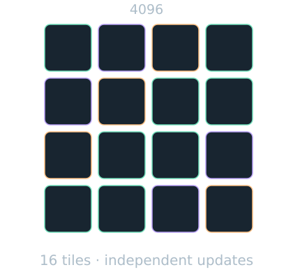{.diagram fig-alt="A 4096 by 4096 matrix split into sixteen independent 1024 by 1024 tiles."}
:::
::::

::: {.takeaway}
A <code>DArray</code> is a tiled array. Each entry in <code>.chunks</code> is a tile handle.
:::

::: {.notes}
13:00–16:00. Here A is 4096×4096 and double!(X) does X .*= 2.
There are sixteen tiles, so sixteen independent tasks. Run demos/02_datadeps.jl.
The tile count exposes concurrency; it is not a promise of simultaneous execution.
:::

## One GPU: keep the algorithm

```julia
using Dagger, AMDGPU

gpu = Dagger.scope(rocm_gpu=1)
Dagger.with_options(scope=gpu) do
    # Construct tiles and run the same Datadeps code here.
end
```

::: {.cards}
::: {.card}
<h3>Place</h3>
Scope selects the GPU.
:::
::: {.card}
<h3>Move</h3>
Dagger transfers tile data.
:::
::: {.card}
<h3>Dispatch</h3>
Supported BLAS/LAPACK calls use GPU libraries.
:::
:::

::: {.notes}
16:00–20:00. Run demos/03_gpu.jl: unchanged doubling, a ROCArray type, and
correct matrix multiplication. User functions must support GPU arrays;
arbitrary CPU-only code is not automatically a GPU kernel. For the Cholesky
exercise, spawn BLAS/LAPACK calls directly so Dagger can select replacements.
:::

## One server. Multiple GPUs. One algorithm.

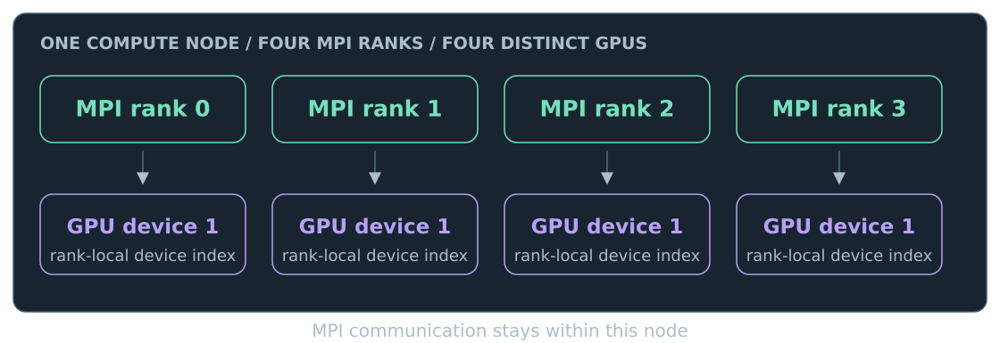{.diagram fig-alt="One Julia process on one server splits A into two block rows. GPU 1 computes C1 = A1 times B, and GPU 2 computes C2 = A2 times B. The two block rows form one output matrix C = A times B."}

```julia
gpus = Dagger.scope(rocm_gpus=1:2)
```

::: {.takeaway}
Split one matrix product into output tiles. Schedule those tiles on distinct GPUs.
:::

::: {.notes}
20:00–22:00. Multi-GPU on a server does not require MPI. One Julia process
can schedule tasks onto GPU devices 1 and 2. The scope above selects both.
Walk through C = A * B: split A into block rows, reuse B for both, and compute
the corresponding block rows of C on different GPUs. This is one matrix product.
The demo explicitly places one output-tile task on each selected GPU so device
participation is visible. Dagger moves inputs and tracks the output writes.
On Odo the GPU device IDs refer to MI250X GCDs; two IDs need not mean two packages.
:::

## One product. Two GPUs. {.demo}

::: {.small}
In the allocation shell, after leaving the Julia REPL with <code>exit()</code>:
:::

```bash
bash frontier/launch.sh 1 demos/05_multigpu.jl
```

```text
One matrix product: A(1024, 512) * B(512, 512)
  output tile row 1 -> GPU 1 on odo03
  output tile row 2 -> GPU 2 on odo03
PASS: C ≈ A * B
GPUs: 2 | nodes: 1 | Julia processes: 1
```

::: {.takeaway}
One process, one result, two distinct GPU devices doing matrix multiplication.
:::

::: {.source-note}
Example output; hostname varies. Add <code>--gpus=4</code> to use four GPUs.
:::

::: {.notes}
22:00–23:00. The shell command is one line. The launcher's argument 1 requests
one Julia process, not one GPU; the demo selects two GPU devices by default.
No device-visibility environment variables are set by attendees. Slurm exposes
the allocated GPUs and the application uses Dagger scopes to choose among them.
The reporting helper calls mul! on a GPU output tile, synchronizes that GPU,
and returns the actual device identity. The demo verifies distinct physical
devices using hostname plus PCI address internally, and checks C against A * B.
Each output row belongs to the same C; no independent full-product replicas.
Exit the warm REPL first because its step reserves these GPU resources.
:::

## Multiple nodes: add MPI

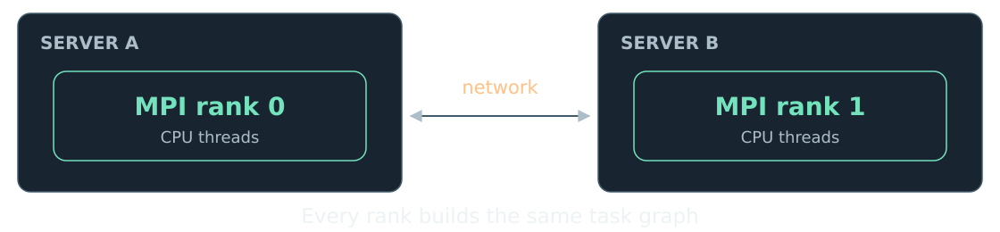{.diagram fig-alt="MPI connects rank 0 on server A and rank 1 on server B over a network. Each rank runs CPU tasks as part of the same Dagger program."}

```bash
bash frontier/multinode.sh cpu
```

::: {.takeaway}
Two servers contribute tiles to one <code>C = A * B</code>. Check PASS and two hostnames.
:::

::: {.small}
Presenter demo: requires a two-node allocation. Attendees keep same-node MPI.
:::

::: {.notes}
23:00–24:00. Introduce MPI only after single-process multi-GPU. Explain SPMD:
every rank builds the same graph, with deterministic input and uniform decisions.
Keep rank-0-only branches for reporting; do not put the Dagger work inside one.
The shared implementation enables Dagger.accelerate!(:mpi), builds the same
matrix product on every rank, and explicitly places output tiles across ranks.
The entry script demos/06_multinode.jl requires two distinct compute hosts,
checks the assembled result, and reports the hosts that executed the tile tasks.
Run the shell command in the presenter's prepared two-node allocation.
The attendee launch remains bash frontier/launch.sh 2 demos/04_mpi.jl on one node.
That exercises the programming model without claiming inter-server communication.
Do not request additional attendee nodes. See the appendix for presenter setup.
:::

## Multiple nodes × multiple GPUs

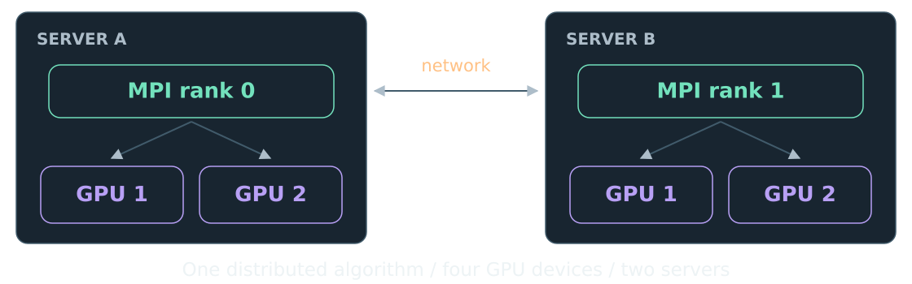{.diagram height=285 fig-alt="Two servers each host one MPI rank and two GPU devices. MPI connects the ranks across the network; GPU scopes distribute tiles within each server. All four GPUs contribute to one distributed algorithm."}

```bash
bash frontier/multinode.sh gpu
```

::: {.takeaway}
One <code>C = A * B</code>, two servers, four GPU devices. Check PASS and the device counts.
:::

::: {.small}
Presenter demo: one MPI rank per server, two GPUs per rank.
:::

::: {.notes}
24:00–25:00. Compose the two ideas in the order just taught. All ranks execute
the same tiled algorithm, and each rank can schedule tasks on more than one GPU.
The illustrated layout has two hosts and four distinct GPU devices, not copies
of one rank-local GPU. MPI rank count and GPUs per rank are separate choices.
The scope applies to devices visible to each rank; the selected hardware layout
must expose those devices. Avoid device-mask configuration in this teaching flow.
Our Odo MPI/GPU path uses host-staged transfers; do not imply GPU-direct networking.
The entry script demos/07_multinode_multigpu.jl uses the same matrix-product
implementation as the previous CPU and single-node GPU demos. It requires
two distinct hosts and at least two GPUs per rank, and checks physical device
identities as well as the numerical result. The shell wrapper requests one
rank and two GPUs on each node in the presenter's two-node allocation.
Attendee MPI exercises and optional four-rank GPU checks keep one attendee node.
:::

## Your algorithm: tiled Cholesky

:::: {.columns}
::: {.column width="45%"}
::: {.lead}
Factor a symmetric positive-definite matrix: **A = LLᵀ**.
:::

Work on the lower triangle,<br>one panel at a time.

::: {.small}
The harness creates the matrix and checks the residual for you.
:::
:::
::: {.column width="51%"}
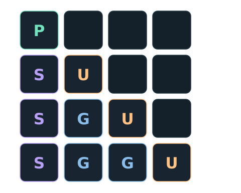{.diagram fig-alt="At panel k equals 1 of a four by four tile grid: POTRF factors the first diagonal tile; TRSM solves the column below it; SYRK updates the remaining diagonal; GEMM updates the other lower-triangular tiles."}
:::
::::

::: {.kernel-key}
<span><b>P</b> POTRF · factor</span><span><b>S</b> TRSM · solve</span><span><b>U</b> SYRK · update</span><span><b>G</b> GEMM · update</span>
:::

::: {.notes}
25:00–27:00. Explain just enough linear algebra to navigate the template.
All four operations are already supplied. Nobody needs to derive Cholesky.
The illustration is the first panel, not every operation in the factorization.
:::

## Dependencies unlock the next panel

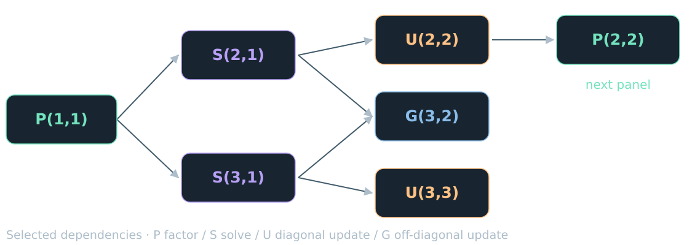{.diagram .full-diagram fig-alt="POTRF of tile 1,1 feeds TRSM tasks for tiles 2,1 and 3,1. These feed SYRK updates of diagonal tiles and a GEMM update of tile 3,2. SYRK of tile 2,2 enables the next POTRF without waiting for unrelated updates."}

::: {.takeaway}
The next panel can start as soon as its own inputs are ready.
:::

::: {.notes}
27:00–28:00. This is a selected dependency subgraph, not the full four-tile DAG.
Both solves must complete for the GEMM that reads them. The next diagonal
factorization needs its own update, not all trailing updates. Dagger derives
these dependencies from the declared accesses; no hand-written DAG is needed.
:::

## Three edits. Keep the loops.

::: {.eyebrow}
Open exercise/my_cholesky.jl
:::

::: {.cards}
::: {.card}
::: {.number}
1
:::
<h3>Wrap the region</h3>
Put the loop nest inside <code>spawn_datadeps</code>.
:::
::: {.card}
::: {.number}
2
:::
<h3>Spawn the kernels</h3>
Add <code>Dagger.@spawn</code> to each BLAS/LAPACK call.
:::
::: {.card}
::: {.number}
3
:::
<h3>Declare access</h3>
Mark each tile argument <code>In</code> or <code>InOut</code>.
:::
:::

::: {.takeaway}
Keep GPU/MPI setup outside your function. Keep <code>fetch</code> and <code>wait</code> outside the region.
:::

::: {.notes}
28:00–29:00. Show the template and serial version side by side in the editor.
The supplied student template intentionally fails until annotated. Return T.
Spawn the actual BLAS/LAPACK function, not a helper containing the call.
Do not reveal the full answer yet; a reference is in the appendix for debrief.
:::

## A quick access-pattern check

```julia
# Existing diagonal values are replaced by their factor.
Dagger.@spawn LAPACK.potrf!('L', InOut(T[k, k]))
```

::: {.big-statement}
For a solve or update:<br>which tiles are <span class="accent">inputs</span>,<br>and which tile <span class="accent">changes</span>?
:::

::: {.notes}
29:00–30:00. Show one of four calls as a worked example. For TRSM, read
the diagonal and update the column tile. For SYRK, read a column tile and
update a diagonal. For GEMM, read two column tiles and update one trailing tile.
Then hand over to attendees. The next slides stay visible during checkpoints.
:::

## A fast edit → run → see loop

{.diagram fig-alt="Edit the student file, run the warm benchmark, check PASS, and view the plot. Then repeat."}

```bash
bash frontier/repl.sh
```

```julia
TutorialSession.benchmark(impl="student")
TutorialSession.plot()
```

::: {.takeaway}
Keep Julia alive. Edits reload; unchanged code stays compiled.
:::

::: {.notes}
At 30:00. For continuous Odo access, a prepared compute allocation and shared
depot are prerequisites. If access is rotated, use the replacement schedule in
PLAN.md: start with ten minutes of local CPU work, then the assigned Odo windows.
The checkpoint timings below describe the continuous-access schedule.
This command launches the compute-node REPL; it is not a login-node workload.
Defaults are a small 1024 matrix, 256 tiles, and one trial for quick feedback.
The MPI prompt is different from the Julia REPL. We will switch explicitly.
:::

## {.exercise-slide}

<div class="exercise-title"><h2>Checkpoint 1 / CPU</h2><span class="time">12 minutes</span></div>

::: {.checkpoint}
30:00–42:00 · Edit → run → PASS
:::

```julia
TutorialSession.benchmark(impl="student")
```

::: {.lead}
Annotate all four kernels. Keep the algorithm and return <code>T</code>.
:::

::: {.takeaway}
Stuck? Inspect every tile that changes: does it have <code>InOut</code>?
:::

::: {.notes}
Leave this slide visible for most of the twelve minutes. Walk the room.
Confirm source was saved. A MethodError involving DTask often means a call
is missing Dagger.@spawn or lies outside the Datadeps region. If environment
setup is suspect, --impl=solution is an instructor diagnostic, not the exercise.
Shell fallback: bash frontier/run.sh 1 --impl=student.
:::

## {.exercise-slide}

<div class="exercise-title"><h2>Checkpoint 2 / GPU</h2><span class="time">8 minutes</span></div>

::: {.checkpoint}
42:00–50:00 · Same function, different target
:::

```julia
TutorialSession.benchmark(impl="student", target="gpu")
TutorialSession.plot()
```

::: {.lead}
Get **PASS** first. Then rerun with <code>sizes=[4096], bs=512</code>.
:::

::: {.terminal-note}
The first GPU call compiles. Compare timed trials after warm-up.
:::

::: {.notes}
Spend eight minutes. No changes to my_cholesky! should be required. If a helper
fails on GPU, spawn BLAS/LAPACK directly. Stretch: target="gpu", gpus="all",
sizes=[4096], bs=512. Do not treat tiny matrices as a peak-performance test.
Shell fallback: bash frontier/run.sh 1 --impl=student --target=gpu.
:::

## {.exercise-slide}

<div class="exercise-title"><h2>Checkpoint 3 / MPI</h2><span class="time">6 minutes</span></div>

::: {.checkpoint}
50:00–56:00 · Test the mutation annotations across ranks
:::

```bash
# First: exit() from the Julia REPL to release its step.
bash frontier/mpi-repl.sh 2
```

At the **mpi>** prompt:

```text
--impl=student --strict --sizes=1024 --bs=256
```

::: {.takeaway}
<code>--strict</code> stress-tests dependencies across ranks: missing writes are easier to catch.
:::

::: {.notes}
Six minutes. Two ranks on one node are sufficient for attendees. MPI warm-up
defaults to GPU and may take tens of seconds; start it promptly. Add
--target=gpu to test GPU ranks. The strict option is a useful stress check,
not proof of correctness for arbitrary inputs. A deliberately wrong all-In
implementation failed it in our Odo validation. Type quit to release the step.
:::

## Make performance visible

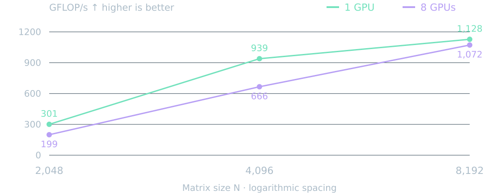{.diagram .full-diagram fig-alt="Measured Odo throughput at tile size 1024 for matrices of size 2048, 4096, and 8192. One GPU gives approximately 301, 939, and 1128 GFLOP/s; eight GPUs give 199, 666, and 1072 GFLOP/s. More devices do not improve these samples."}

::: {.source-note}
Odo rehearsal · October 14, 2026 · reference solution · 56 Julia threads · tile 1024 · best of 2 passing trials · compilation excluded. Source: data/odo-fixed.csv.
:::

::: {.notes}
56:00–57:00. These are saved, corrected-environment measurements, not a live
claim. Same tile size within this chart. Only three tested sizes are connected;
the lines guide the eye. Ask attendees to compare with their own terminal plot.
Larger matrices amortize some overhead; we have not isolated its causes.
:::

## More GPUs is a hypothesis to test

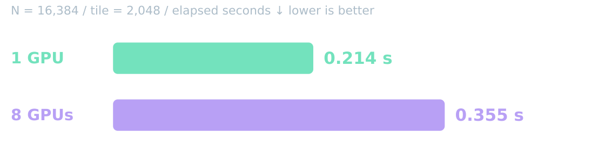{.diagram fig-alt="At matrix size 16384 and tile size 2048, one GPU takes 0.214 seconds and eight GPUs take 0.355 seconds, best of two passing trials. Eight GPUs are slower in this sample."}

::: {.takeaway}
Discuss tile count, data movement, scheduling overhead, and the critical path.
:::

::: {.source-note}
Odo rehearsal · October 14, 2026 · reference solution · 56 Julia threads · both residual checks PASS · best of 2 trials. Rehearsal samples; no peak-performance claim.
:::

::: {.notes}
57:00–58:00. No eight-GPU speedup here. Avoid claiming that one specific factor
caused the result: the measurements do not isolate causes. At N=16384,
bs=2048 there are 8×8 tiles. Tile size changes both task count and kernel size.
Compare the builtin and vendor baselines as stretch work, not as extra homework.
:::

## Look at overlap, then ask why

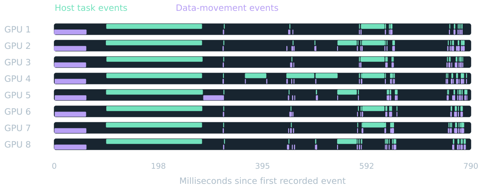{.diagram .full-diagram fig-alt="Eight GPU processor lanes from a real Dagger trace show the timing and overlap of host-side compute-task and data-movement events."}

::: {.source-note}
Recorded eight-GPU run · N=2048, tile 512 · host-side Dagger task/movement events. Trace logging adds overhead; this is not a GPU kernel profile or the timing source for the previous charts.
:::

::: {.notes}
58:00–59:00. Each row is a GPU processor lane. Mint means task execution events;
violet means data-movement events. Lanes can contain overlapping events; this
is a task trace, not hardware utilization. Open the full saved trace in Perfetto
if useful. Use untraced trials when comparing performance. Discuss waiting,
overlap, and critical-path structure without assigning a cause from this view alone.
:::

## What did your plot teach you?

::: {.closing-row}
<span class="num">01</span><p>Which configuration passed everywhere?</p>
:::
::: {.closing-row}
<span class="num">02</span><p>What changed when you changed tile size?</p>
:::
::: {.closing-row}
<span class="num">03</span><p>What would you measure next?</p>
:::

::: {.notes}
59:00–60:00, including the next slide. Take one or two brief answers.
Do not let the success criterion become beating a vendor library on one device.
The win today is a correct portable task program and a defensible measurement.
:::

## Describe access.<br>Expose parallelism.<br><span class="accent">Measure the result.</span> {.closing}

::: {.subtitle}
One algorithm. A task graph. Room to grow.
:::

::: {.byline}
Continue in <code>exercise/README.md</code> · Reference in <code>solution/my_cholesky.jl</code>
:::

::: {.notes}
End of the main deck. Everything after this slide is optional reference material.
Esc opens the slide overview. S opens speaker notes when served over HTTP.
:::

## Appendix / Launch reference

::: {.small}
Run inside the appropriate compute allocation, from <code>02-Parallel-Programming/Dagger/</code>.
:::

```bash
# CPU → GPU → strict MPI
bash frontier/run.sh 1 --impl=student
bash frontier/run.sh 1 --impl=student --target=gpu
bash frontier/run.sh 2 --impl=student --mpi --strict

# Presenter or attendee: four GPU ranks on one node
SC26_NODES=1 bash frontier/run.sh 4 \
  --impl=solution --mpi --strict --target=gpu
```

::: {.notes}
Exit warm steps that occupy needed resources before launching another step.
Obtain one node in advance with bash frontier/allocate.sh.
The last command requests four ranks with one GPU each on that node.
:::

## Appendix / Two-node presenter setup

::: {.small}
On the login node, after leaving any previous allocation:
:::

```bash
SC26_NODES=2 bash frontier/allocate.sh
# Inside the new allocation:
export SC26_NODES=1
bash frontier/multinode.sh cpu
bash frontier/multinode.sh gpu
```

::: {.takeaway}
The multi-node wrapper selects both nodes. Ordinary examples keep using one.
:::

::: {.small}
25 attendee nodes + 2 presenter nodes = 27 nodes to reserve.
:::

::: {.notes}
allocate.sh downloads packages on the login node before requesting two nodes.
Setting SC26_NODES=1 inside that allocation keeps the earlier launch commands
valid; it does not release the second allocated node. The multi-node wrapper
overrides the step layout to two ranks on two nodes and checks allocation size.
Exit REPL steps that reserve resources before launching these demos. Rehearse
both scripts on the actual hosts and keep recordings for limited-capacity days.
:::

## Appendix / The four access patterns

::: {.compact-code}
```julia
# Inside Dagger.spawn_datadeps() do ... end
Dagger.@spawn LAPACK.potrf!('L', InOut(T[k, k]))

Dagger.@spawn BLAS.trsm!('R', 'L', 'T', 'N', 1.0,
    In(T[k, k]), InOut(T[m, k]))

Dagger.@spawn BLAS.syrk!('L', 'N', -1.0,
    In(T[n, k]), 1.0, InOut(T[n, n]))

Dagger.@spawn BLAS.gemm!('N', 'T', -1.0,
    In(T[m, k]), In(T[n, k]), 1.0, InOut(T[m, n]))
```
:::

::: {.takeaway}
Read the panel tiles. Update the destination tile in place.
:::

::: {.notes}
Reveal only after the exercise or when needed to unblock the room. The full
loop nest and return value remain in solution/my_cholesky.jl. These calls
must stay in their original sequential loop order within the Datadeps region.
:::

## Appendix / Independent access for 25

::: {.cards}
::: {.card}
::: {.number}
25
:::
<h3>Independent attendees</h3>
Own account, code, and results.<br>One compute node each.
:::
::: {.card}
::: {.number}
1–2
:::
<h3>Presenter nodes</h3>
One for the standard layout.<br>Two for live multi-node demos.
:::
::: {.card}
::: {.number}
26–27
:::
<h3>Nodes to reserve</h3>
25 attendee nodes + 1–2 presenter nodes.<br>Three or two spare against the recorded 29 healthy.
:::
:::

::: {.source-note}
Attendees keep one node each. Optional multi-node presenter demos add one reserved node. Independent access fits the recorded whole-node policy without node sharing. Details in PLAN.md.
:::

::: {.notes}
Organizer reference, not teaching content. The October 14 inspection found
30 batch nodes with one drained and whole-node exclusive jobs. Twenty-five
attendees plus one presenter require 26 healthy nodes, leaving three spare
if the remaining recorded capacity is available. Each attendee uses one node
for CPU, multi-GPU, two MPI ranks, and the optional four-rank GPU run.
The presenter keeps one node by default, or two for live CPU/GPU multi-node
demos. Those demos verify two physical hosts and require 27 total reserved
nodes; the one-node presenter layout requires 26. Attendee MPI stays within
each attendee's node. Node-sharing approval is unnecessary. If fewer nodes
are available, PLAN.md describes two independent access
windows of 13 and 12 attendees plus one presenter (14 nodes at peak), with
preflighted local CPU work outside each window. No class-scale rehearsal has
yet validated the fallback timing. An idle allocation still owns its node.
:::

## Appendix / Validated environment

| Component | Rehearsal baseline · October 14, 2026 |
|---|---|
| Dagger | 0.22.7 · master commit `034f72a` |
| AMDGPU | Compatible upstream fix `482cd05` |
| Julia / ROCm | 1.13.1 / 6.4.2 |
| MPI | Cray MPICH 8.1.31 · host-staged GPU transfers |
| Historical checks | CPU, GPU, eight GPUs, MPI, earlier two-node runs, strict residuals |

::: {.takeaway}
Download on the login node. Precompile and run on compute nodes. Revalidate after updates.
:::

::: {.notes}
The environment tracks Dagger master on fresh resolution; these hashes name
the tested baseline, not today's master. AMDGPU is pinned for compatible handle
cleanup/context ownership fixes. The full suite passed sixteen compute checks,
plus baselines and negative checks. See PLAN.md and the saved evidence logs.
:::
