## {.hero-slide}

::: {.kicker}
Julia for HPC / SC26 / 02
:::

::: {.hero}
From tasks to<br>[supercomputers.]{.accent}
:::

::: {.subtitle}
One tiled algorithm.<br>CPU threads, GPUs, and MPI with Dagger.jl.
:::

::: {.byline}
Julian Samaroo · 60 minutes · Live code + hands-on
:::

::: {.notes}
Welcome. This follows Julia and parallel, portable GPU programming. The goal is to describe data
dependencies once and keep the algorithm as we change execution targets.
Keep the terminal and Julia sessions warm before the audience arrives.
:::

## From GPU kernels to a whole application

::: {.eyebrow}
Building on the previous session
:::

::: {.cards}
::: {.card}
<h3>You have GPU work</h3>
Portable kernels and device-aware operations.
:::
::: {.card}
<h3>Now connect the work</h3>
Dependencies, mutable data, and tiled algorithms.
:::
::: {.card}
<h3>Then choose placement</h3>
CPU threads, multiple GPUs, and MPI ranks.
:::
:::

::: {.takeaway}
Dagger coordinates tasks and data around operations that can run on each device.
:::

::: {.notes}
Use the previous GPU section as shared context. Ask what happens when a GPU
operation needs another operation's output, or when there is more than one GPU.
Avoid reteaching GPU kernels. This section moves up to application orchestration;
device-compatible functions and supported library operations remain necessary.
Keep this bridge within the opening three minutes.
:::

## Your next hour

::: {.cards}
::: {.card}
::: {.number}
01
:::
<h3>Build the model</h3>
Tasks, data access, tiles.<br>First 20 minutes.
:::
::: {.card}
::: {.number}
02
:::
<h3>Scale the same code</h3>
GPU scopes and MPI.<br>Next 10 minutes, with the exercise brief.
:::
::: {.card}
::: {.number}
03
:::
<h3>Make it yours</h3>
Parallel tiled Cholesky.<br>30 minutes of hands-on work.
:::
:::

::: {.takeaway}
Success = correct results on each target, plus a plot you can explain.
:::

::: {.notes}
0:00–3:00, including the next slide. All commands are run from 02-Parallel-Programming/Dagger/.
Confirm the chosen access schedule. With rotated Odo access, attendees obtain
allocations only in their assigned windows and start CPU work locally.
This deck supports the demos; switch to the terminal often.
:::

## You describe work. Dagger places it.

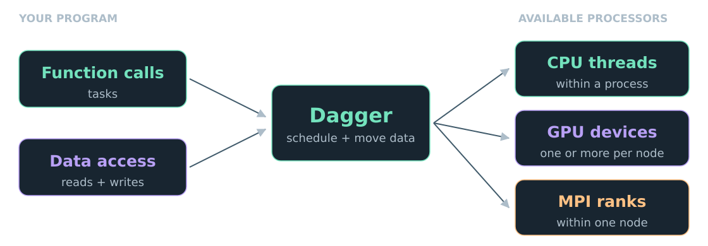{.diagram .full-diagram fig-alt="Tasks with data dependencies flow through Dagger's scheduler to CPU threads, GPU devices, and MPI ranks."}

::: {.takeaway}
The dependency graph exposes what can happen at the same time.
:::

::: {.notes}
Explain the division of responsibility: calls and data access in the program;
placement, dependency enforcement, and movement in the runtime. Placement is
constrained by available processors and scopes. It does not guarantee a speedup.
:::

## A task result is also a dependency

:::: {.columns}
::: {.column width="58%"}
```julia
using Dagger

a = Dagger.@spawn rand(2000, 2000)
b = Dagger.@spawn rand(2000, 2000)
c = Dagger.@spawn a * b
d = Dagger.@spawn sum(c)

fetch(d)
```
:::
::: {.column width="38%"}
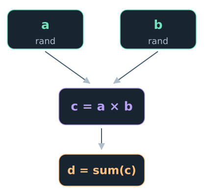{.diagram fig-alt="Independent random-matrix tasks a and b feed matrix multiplication c, which feeds sum d."}
:::
::::

::: {.takeaway}
Pass task handles onward. Fetch the final answer when you need it.
:::

::: {.notes}
3:00–6:00. a and b are independent. c waits for both. d waits for c.
Spawn returns a handle promptly. No manual wait is needed between these calls.
Ask: which two tasks could overlap? Use the graph rather than terminology.
:::

## Run the graph. See the threads. {.demo .task-demo}

```julia-repl
julia> include("demos/01_tasks.jl")
```

:::: {.columns}
::: {.column width="48%"}
::: {.eyebrow}
01 / A matrix computation
:::

```julia
a = Dagger.@spawn rand(2000, 2000)
b = Dagger.@spawn rand(2000, 2000)
c = Dagger.@spawn a * b
d = Dagger.@spawn sum(c)
println("sum = ", fetch(d))
```

::: {.demo-output}
```text
sum = 2.000272931218996e9
```
:::

::: {.small}
Two matrices → product → sum.<br>
<code>fetch(d)</code> waits for the whole graph.
:::
:::

::: {.column width="48%"}
::: {.eyebrow}
02 / Eight independent tasks
:::

```julia
whereami() = (sleep(0.1); Threads.threadid())
tids = fetch.([
    Dagger.@spawn whereami() for _ in 1:8
])
println("ran on threads: ", tids)
```

::: {.demo-output}
```text
ran on threads: [2, 7, 5, 3, 6, 4, 1, 7]
```
:::

::: {.small}
Each task reports its thread ID.<br>
Different IDs show execution across CPU threads.
:::
:::
::::

::: {.takeaway}
Dependencies order the matrix tasks. Independent tasks can overlap.
:::

::: {.source-note}
Example output from Odo; random values and thread assignments vary.
:::

::: {.notes}
6:00–8:00. Run it from the console's CPU section (Tasks & dependencies), not on the login node.
The include executes both code excerpts; using Dagger is omitted here.
First explain the computation: generate two independent 2000-by-2000 random
matrices, multiply them once both are ready, then reduce the product to a scalar.
The printed sum comes from fetch(d), after that graph finishes. There are no
manual waits between the four task submissions.
Then explain the separate thread probe: eight independent tasks each sleep for
0.1 seconds and report their thread ID. Sleep gives the tasks a chance to overlap.
The IDs belong to this probe, not to the matrix tasks above; they show placement
across threads, without measuring how much execution overlapped or any speedup.
The output shown is from the October 21 Odo validation. A run need not use every
CPU thread, and the numeric sum and thread assignments will vary.
Point from each output line back to the code that produced it. Then return to slides.
:::

## Mutation needs one extra piece of information

::: {.lead}
Which arguments does this task read or write?
:::

::: {.cards .access}
::: {.card}
<h3>`In(x)`</h3>
Read existing values.
:::
::: {.card}
<h3>`Out(x)`</h3>
Write new values.<br>Old contents are unused.
:::
::: {.card}
<h3>`InOut(x)`</h3>
Read existing values<br>and write updates.
:::
:::

::: {.takeaway}
An update that reads old values needs <code>InOut</code>, even if its return value is unused.
:::

::: {.notes}
8:00–11:00. These annotations let Datadeps preserve the sequential program's
meaning while overlapping independent accesses. Multiple readers may overlap.
Two conflicting accesses to the same data must preserve their order.
Out is appropriate for copyto!'s destination; not for accumulation.
:::

## Predict the dependency

```julia
Dagger.spawn_datadeps() do
    Dagger.@spawn add!(InOut(B), In(A))
    Dagger.@spawn copyto!(Out(C), In(B))
end
```

{.diagram fig-alt="The task that writes B must finish before the task that reads B and writes C."}

::: {.takeaway}
Could these two calls overlap? What if they wrote different arrays?
:::

::: {.notes}
11:00–13:00. add!(X,Y) means X .+= Y, as defined in demos/02_datadeps.jl.
Let the audience answer before pointing at the graph. Both calls touch B, and
the first writes it. The Datadeps region completes its work before returning.
Demonstrate the correctness assertion in demo 2 after introducing tiles.
:::

## Tiles give the scheduler room to work

:::: {.columns}
::: {.column width="58%"}
```julia
A = rand(4096, 4096)
DA = DArray(A, Blocks(1024, 1024))

Dagger.spawn_datadeps() do
    for tile in DA.chunks
        Dagger.@spawn double!(InOut(tile))
    end
end
```
:::
::: {.column width="38%"}
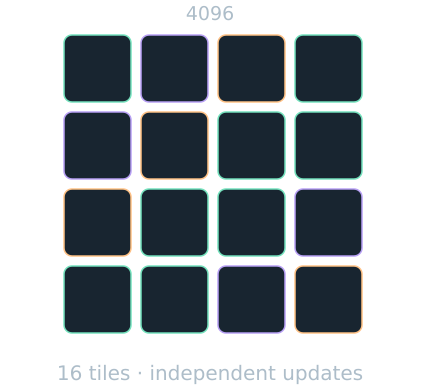{.diagram fig-alt="A 4096 by 4096 matrix split into sixteen independent 1024 by 1024 tiles."}
:::
::::

::: {.takeaway}
A <code>DArray</code> is a tiled array. Each entry in <code>.chunks</code> is a tile handle.
:::

::: {.notes}
13:00–16:00. Here A is 4096×4096 and double!(X) does X .*= 2.
There are sixteen tiles, so sixteen independent tasks. Run demos/02_datadeps.jl.
The tile count exposes concurrency; it is not a promise of simultaneous execution.
:::

## One GPU: keep the algorithm

```julia
using Dagger, AMDGPU

gpu = Dagger.scope(rocm_gpu=1)
Dagger.with_options(scope=gpu) do
    # Construct tiles and run the same Datadeps code here.
end
```

::: {.cards}
::: {.card}
<h3>Place</h3>
Scope selects the GPU.
:::
::: {.card}
<h3>Move</h3>
Dagger transfers tile data.
:::
::: {.card}
<h3>Dispatch</h3>
Supported BLAS/LAPACK calls use GPU libraries.
:::
:::

::: {.notes}
16:00–20:00. Run demos/03_gpu.jl: unchanged doubling, a ROCArray type, and
correct matrix multiplication. User functions must support GPU arrays;
arbitrary CPU-only code is not automatically a GPU kernel. For the Cholesky
exercise, spawn BLAS/LAPACK calls directly so Dagger can select replacements.
:::

## Motivating Problem: a matrix product, two GPUs

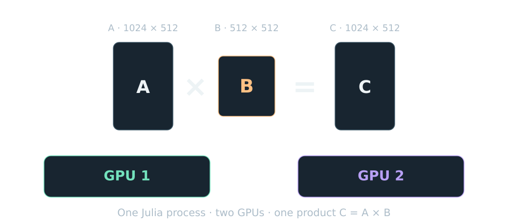{.diagram .full-diagram fig-alt="One product, A times B equals C. One Julia process on one server has two GPU devices available."}

::: {.notes}
Hold the setup one beat: A(1024, 512), B(512, 512), output C(1024, 512), and a
two-GPU scope in one Julia process. The products are the actors; the next slide
shows how this product splits into block rows.
:::

## The naive way: Split A, Split C

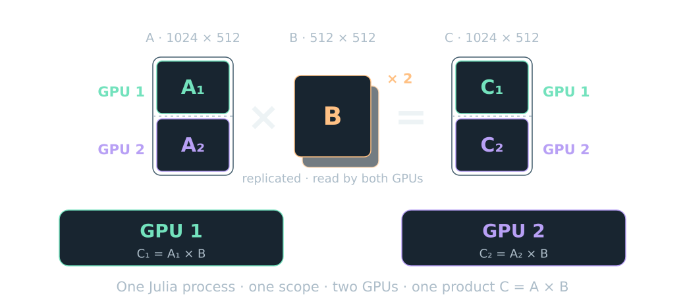{.diagram .full-diagram fig-alt="One matrix product split into two block rows. A reads as two tiles, its upper block row A one in mint and lower block row A two in violet. Matrix B is one shared amber tile. GPU one computes C one equals A one times B, and GPU two computes C two equals A two times the same B. The two block rows stack into the one output matrix C = A times B."}

::: {.notes}
Transition from one GPU to two devices on one server. The picture shows the
product slide's demo, A(1024, 512) times B(512, 512): A carries two 512×512
block rows, B is shared and read by both tasks, and each output block row
lands on a distinct GPU. Nothing MPI-shaped yet, this is still one Julia
process. Run demos/05_multigpu.jl here.
:::

## Multiple nodes: add MPI

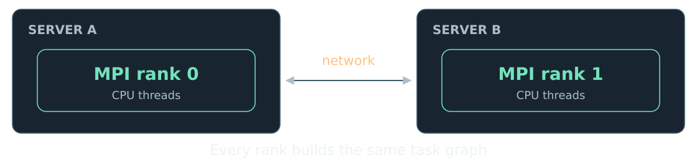{.diagram fig-alt="MPI connects rank 0 on server A and rank 1 on server B over a network. Each rank runs CPU tasks as part of the same Dagger program."}

::: {.takeaway}
Two MPI ranks contribute tiles to one <code>C = A * B</code>. Check PASS and two processes.
:::

::: {.small}
Odo tutorial resource limits: both ranks share one node. The same MPI code runs across nodes.
:::

::: {.notes}
23:00–24:00. Introduce MPI only after single-process multi-GPU. Explain SPMD:
every rank builds the same graph, with deterministic input and uniform decisions.
Keep rank-0-only branches for reporting; do not put the Dagger work inside one.
The shared implementation enables Dagger.accelerate!(:mpi), builds the same
matrix product on every rank, and explicitly places output tiles across ranks.
The diagram shows a possible two-server deployment; Odo tutorial capacity
places both ranks on one server for this live demo.
The entry script demos/06_multinode.jl requires two MPI ranks, checks the
assembled result, and reports where the tile tasks executed. MPI coordinates separate processes
on either one host or several; only launcher placement changes.
The attendee launch remains bash frontier/launch.sh 2 demos/06_multinode.jl on one node.
That exercises the programming model without claiming inter-server communication.
The same-node demo does not measure inter-node network performance.
No additional attendee or presenter nodes are required.
:::

## Multiple nodes × multiple GPUs

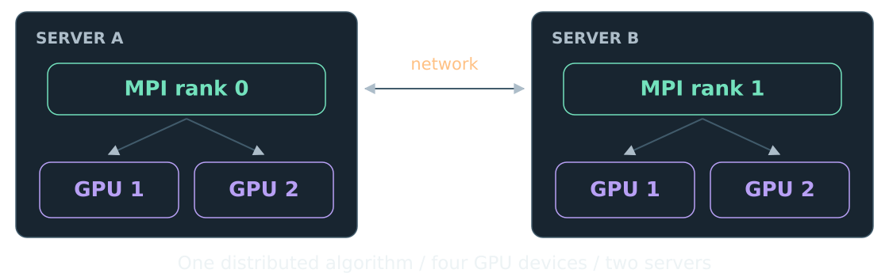{.diagram height=285 fig-alt="Two servers each host one MPI rank and two GPU devices. MPI connects the ranks across the network; GPU scopes distribute tiles within each server. All four GPUs contribute to one distributed algorithm."}

::: {.takeaway}
One <code>C = A * B</code>, two ranks, four distinct GPUs. Check PASS and the device counts.
:::

::: {.small}
Odo tutorial resource limits: two ranks on one node, two GPUs per rank. Same code across nodes.
:::

::: {.notes}
24:00–25:00. Compose the two ideas in the order just taught. All ranks execute
the same tiled algorithm, and each rank can schedule tasks on more than one GPU.
The diagram shows a two-server deployment. The Odo demo places both MPI ranks
on one server, with four distinct GPU devices total. MPI rank count and GPUs
per rank are separate choices.
The scope applies to devices visible to each rank; the selected hardware layout
must expose those devices. Avoid device-mask configuration in this teaching flow.
Our Odo MPI/GPU path uses host-staged transfers; do not imply GPU-direct networking.
The entry script demos/07_multinode_multigpu.jl uses the same matrix-product
implementation as the previous CPU and single-node GPU demos. It requires
two MPI ranks and at least two GPUs per rank, and checks physical device
identities as well as the numerical result. The shell wrapper launches both
ranks on the existing node and exposes two different GPUs to each rank.
The same Julia code also runs across nodes when the launcher places ranks there.
Attendee MPI exercises and optional four-rank GPU checks keep one attendee node.
:::

## Your algorithm: tiled Cholesky

:::: {.columns}
::: {.column width="45%"}
::: {.lead}
Factor a symmetric positive-definite matrix: **A = LLᵀ**.
:::

Work on the lower triangle,<br>one panel at a time.

::: {.small}
The harness creates the matrix and checks the residual for you.
:::
:::
::: {.column width="51%"}
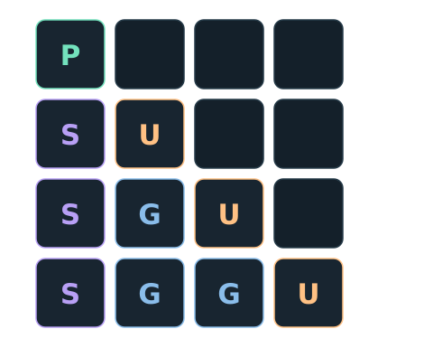{.diagram fig-alt="At panel k equals 1 of a four by four tile grid: POTRF factors the first diagonal tile; TRSM solves the column below it; SYRK updates the remaining diagonal; GEMM updates the other lower-triangular tiles."}
:::
::::

::: {.kernel-key}
<span><b>P</b> POTRF · factor</span><span><b>S</b> TRSM · solve</span><span><b>U</b> SYRK · update</span><span><b>G</b> GEMM · update</span>
:::

::: {.notes}
25:00–27:00. Explain just enough linear algebra to navigate the template.
All four operations are already supplied. Nobody needs to derive Cholesky.
The illustration is the first panel, not every operation in the factorization.
:::

## Dependencies unlock the next panel

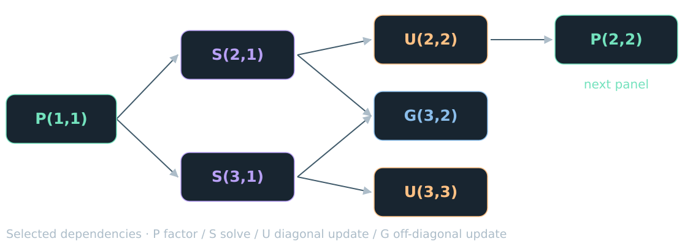{.diagram .full-diagram fig-alt="POTRF of tile 1,1 feeds TRSM tasks for tiles 2,1 and 3,1. These feed SYRK updates of diagonal tiles and a GEMM update of tile 3,2. SYRK of tile 2,2 enables the next POTRF without waiting for unrelated updates."}

::: {.takeaway}
The next panel can start as soon as its own inputs are ready.
:::

::: {.notes}
27:00–28:00. This is a selected dependency subgraph, not the full four-tile DAG.
Both solves must complete for the GEMM that reads them. The next diagonal
factorization needs its own update, not all trailing updates. Dagger derives
these dependencies from the declared accesses; no hand-written DAG is needed.
:::

## Three edits. Keep the loops.

::: {.eyebrow}
Open exercise/my_cholesky.jl
:::

::: {.cards}
::: {.card}
::: {.number}
1
:::
<h3>Wrap the region</h3>
Put the loop nest inside <code>spawn_datadeps</code>.
:::
::: {.card}
::: {.number}
2
:::
<h3>Spawn the kernels</h3>
Add <code>Dagger.@spawn</code> to each BLAS/LAPACK call.
:::
::: {.card}
::: {.number}
3
:::
<h3>Declare access</h3>
Mark each tile argument <code>In</code> or <code>InOut</code>.
:::
:::

::: {.takeaway}
Keep GPU/MPI setup outside your function. Keep <code>fetch</code> and <code>wait</code> outside the region.
:::

::: {.notes}
28:00–29:00. Show the template and serial version side by side in the editor.
The supplied student template intentionally fails until annotated. Return T.
Spawn the actual BLAS/LAPACK function, not a helper containing the call.
Do not reveal the full answer yet; solution/my_cholesky.jl is the reference for the debrief.
:::

## Tiled Cholesky, line by line

:::: {.columns}
::: {.column width="60%" .compact-code}
```julia
for k in 1:mt
    T[k,k] = chol(T[k,k])                      # P
    for m in k+1:mt
        T[m,k] = T[m,k] / T[k,k]'              # S
    end
    for n in k+1:mt
        T[n,n] = T[n,n] - T[n,k] * T[n,k]'     # U
        for m in n+1:mt
            T[m,n] = T[m,n] - T[m,k] * T[n,k]' # G
        end
    end
end
```
:::
::: {.column width="36%"}
::: {.small}
<code>T</code> is an <code>mt × mt</code> grid of tiles: <code>T[i,j]</code> is tile <code>(i, j)</code> of <code>A</code>. Only the lower triangle is read or written.
:::

::: {.small}
<code>X / B</code> is Julia's right division, <code>X * inv(B)</code>.
:::

::: {.small}
When step <code>k</code> ends, column <code>k</code> of <code>T</code> holds column <code>k</code> of <code>L</code>, and the trailing tiles hold what is left to factor.
:::
:::
::::

::: {.kernel-key}
<span><b>P</b> POTRF · factor</span><span><b>S</b> TRSM · solve</span><span><b>U</b> SYRK · update</span><span><b>G</b> GEMM · update</span>
:::

::: {.notes}
The whole algorithm, in matrix notation: this is exercise/serial_cholesky.jl
without the BLAS spelling. Four loops, four tile operations. Point out that each
line writes exactly one tile, the left-hand side, and reads the tiles on its
right-hand side; that is all Datadeps needs. The next slide puts these lines on
the tile grid.
:::

## Step k on the tile grid

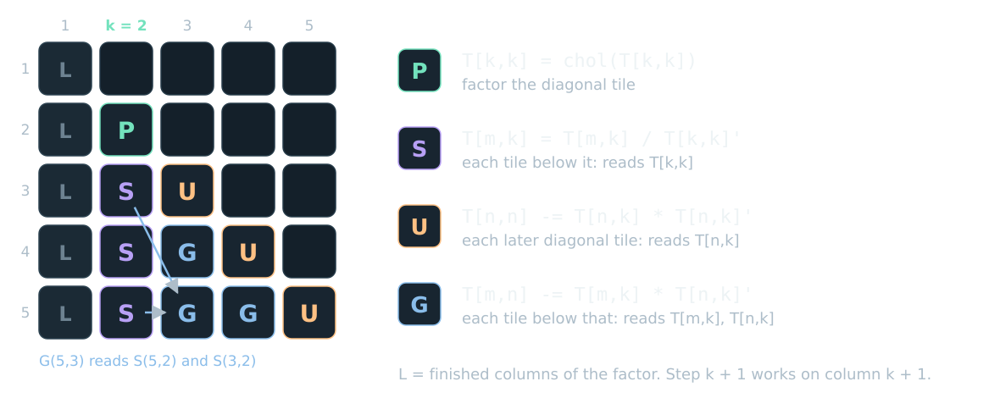{.diagram .full-diagram fig-alt="Step k equals 2 of a five by five tiled Cholesky. Column 1 holds finished tiles of L. POTRF factors tile 2,2. TRSM solves tiles 3,2, 4,2 and 5,2, each reading tile 2,2. SYRK updates diagonal tiles 3,3, 4,4 and 5,5. GEMM updates tiles 4,3, 5,3 and 5,4; GEMM of tile 5,3 reads tiles 5,2 and 3,2. A legend repeats each line of the loop nest next to its colour."}

::: {.takeaway}
Each line writes one tile and reads a few others. Those reads and writes are the dependencies.
:::

::: {.notes}
Step k = 2 of five tile columns. Column 1 is already L. P factors the diagonal
tile; every S tile below it needs that factor; every U and G tile needs the S
tiles in its own row and column, as the arrows show for G(5,3). Nothing in step
3 needs all of step 2: P(3,3) waits only for U(3,3). That is the overlap the
earlier dependency slide showed.
:::

## From pseudocode to the template

| | Pseudocode | Call in <code>exercise/my_cholesky.jl</code> |
|-|------------------|--------------------------------|
| <b style="color:var(--mint)">P</b> | <code>T[k,k] = chol(T[k,k])</code> | <code>factor_diagonal_tile!('L', T[k, k])</code> |
| <b style="color:var(--violet)">S</b> | <code>T[m,k] = T[m,k] / T[k,k]'</code> | <code>solve_panel_tile!('R', 'L', 'T', 'N', 1.0, T[k, k], T[m, k])</code> |
| <b style="color:var(--amber)">U</b> | <code>T[n,n] -= T[n,k] * T[n,k]'</code> | <code>update_diagonal_tile!('L', 'N', -1.0, T[n, k], 1.0, T[n, n])</code> |
| <b style="color:#8abdea">G</b> | <code>T[m,n] -= T[m,k] * T[n,k]'</code> | <code>update_offdiagonal_tile!('N', 'T', -1.0, T[m, k], T[n, k], 1.0, T[m, n])</code> |

::: {.small}
The letters are BLAS flags: <code>'L'</code> use the lower triangle · <code>'R'</code> the factor is on the right · <code>'T'</code> transpose it · <code>'N'</code> as is.
The scalars <code>-1.0, …, 1.0</code> make an update <i>C ← C − A·Bᵀ</i>. The last tile argument is the one written, in place.
:::

::: {.notes}
Each pseudocode line is one BLAS or LAPACK call on whole tiles. Read the flags
once and move on: nobody needs to memorise BLAS argument orders today, they are
already written in the template. The point is that the tile written in place is
always the last tile argument, which is the one that will need InOut.
:::

## Our names are aliases, not wrappers

```julia
const factor_diagonal_tile!    = LAPACK.potrf!   # P
const solve_panel_tile!        = BLAS.trsm!      # S
const update_diagonal_tile!    = BLAS.syrk!      # U
const update_offdiagonal_tile! = BLAS.gemm!      # G
```

::: {.cards}
::: {.card}
<h3>Reads like the picture</h3>
The name says what happens to the tile; the four-letter BLAS name does not.
:::
::: {.card}
<h3>Still the BLAS function</h3>
A <code>const</code> alias is the same function object. Dagger swaps in rocBLAS/rocSOLVER (cuBLAS/cuSOLVER on NVIDIA) when the task lands on a GPU.
:::
::: {.card}
<h3>A wrapper would break it</h3>
A new function that calls <code>BLAS.gemm!</code> hides the call: on a GPU task it runs CPU BLAS on device memory and fails.
:::
:::

::: {.notes}
Why the template looks the way it does. Dagger chooses the GPU implementation
by the identity of the spawned function, so the spawned function must be the
BLAS/LAPACK function itself. A const alias keeps that identity and adds a
readable name; a wrapper function would not be recognised. This is also the
rule for the exercise: spawn the tile operation directly, not a helper around it.
:::

## Look at overlap, then ask why

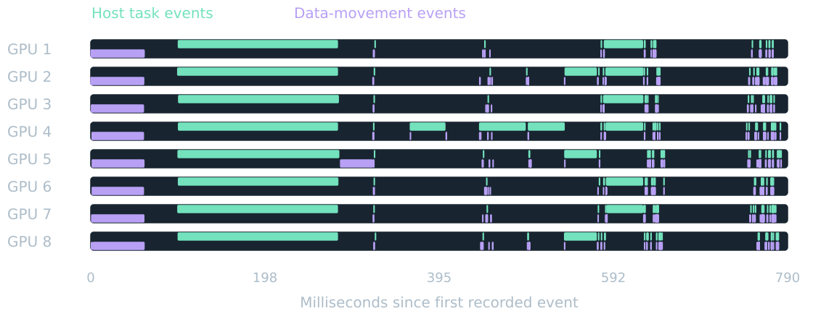{.diagram .full-diagram fig-alt="Eight GPU processor lanes from a real Dagger trace show the timing and overlap of host-side compute-task and data-movement events."}

::: {.source-note}
Recorded eight-GPU run · N=2048, tile 512 · host-side Dagger task/movement events. Trace logging adds overhead; this is not a GPU kernel profile or the timing source for the previous charts.
:::

::: {.notes}
58:00–59:00. Each row is a GPU processor lane. Mint means task execution events;
violet means data-movement events. Lanes can contain overlapping events; this
is a task trace, not hardware utilization. Open the full saved trace in Perfetto
if useful. Use untraced trials when comparing performance. Discuss waiting,
overlap, and critical-path structure without assigning a cause from this view alone.
:::

## What did your plot teach you?

::: {.closing-row}
<span class="num">01</span><p>Which configuration passed everywhere?</p>
:::
::: {.closing-row}
<span class="num">02</span><p>What changed when you changed tile size?</p>
:::
::: {.closing-row}
<span class="num">03</span><p>What would you measure next?</p>
:::

::: {.notes}
59:00–60:00, including the next slide. Take one or two brief answers.
Do not let the success criterion become beating a vendor library on one device.
The win today is a correct portable task program and a defensible measurement.
:::

## What is Gray-Scott?

::: {.lead}
Two chemicals react and spread, and patterns grow by themselves.
:::

::: {.gs-key}
<span><b>React</b> <code>U + 2V → 3V</code>: the activator V feeds on the substrate U</span><span><b>Feed and kill</b> U flows in at rate F; V is removed at rate F + k</span><span><b>Diffuse</b> both spread to neighbours, U twice as fast as V</span>
:::

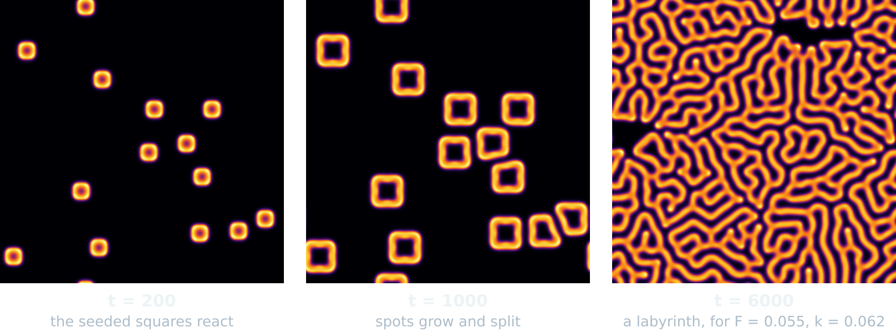{.diagram .gs-frames fig-alt="The activator v of the final exercise at t = 200, 1000 and 6000: fourteen seeded squares become spots, the spots split, and they fill the grid with a labyrinth of stripes."}

::: {.notes}
Gray and Scott's model of an autocatalytic reaction fed with fresh substrate
(1983-84); Pearson (1993) mapped the patterns it makes as F and k change.
Locally, V grows where there is U and dies away elsewhere; diffusion moves U
toward the spots faster than V spreads, which is what lets patterns form instead
of everything mixing to grey. These three frames are the final exercise itself,
with the console's parameters and seed, so attendees know what their run should
show. The next slide is the algorithm.
:::

## Final exercise: Gray-Scott, line by line

:::: {.columns}
::: {.column width="60%" .compact-code}
```julia
L      = periodic 1D Laplacian                  # once
Fu, Fv = cholesky(I - dt/2·Du·L), … Dv …        # once
for step in 1:nsteps
    # first half: y explicit, x implicit
    ru = u + dt/2·(Du·(u·L) - u·v² + F·(1 - u))
    rv = v + dt/2·(Dv·(v·L) + u·v² - (F + k)·v)
    for j in 1:n                 # every column
        u[:, j] = Fu \ ru[:, j];  v[:, j] = Fv \ rv[:, j]
    end
    # second half: x explicit, y implicit
    ru, rv = … the same, with L·u and L·v …
    for i in 1:n                 # every row
        u[i, :] = Fu \ ru[i, :];  v[i, :] = Fv \ rv[i, :]
    end
end
```
:::
::: {.column width="36%"}
::: {.small}
<code>du/dt = Du ∇²u − uv² + F(1 − u)</code><br><code>dv/dt = Dv ∇²v + uv² − (F + k)v</code>
:::

::: {.small}
ADI splitting: each half step treats one direction implicitly and the other explicitly. <code>A = I − (dt/2) D L</code> is SPD and constant, so it is factored once.
:::

::: {.small}
The solves of a half step are independent of each other: that is the loop to spawn as Dagger tasks.
:::
:::
::::

::: {.takeaway}
Cholesky factors the implicit operators once; Dagger runs the independent line solves in parallel.
:::

::: {.notes}
The final exercise in matrix notation. Two fields, u and v, on a periodic
grid. The 2D implicit operator would be an n² × n² system; ADI replaces it with
n small n × n systems per direction, all with the same matrix. That matrix is
SPD and constant, so one Cholesky factorization per field serves every solve of
every step. Within a half step the column (or row) solves do not depend on each
other, which is where the parallelism is.
:::

## One time step on the grid

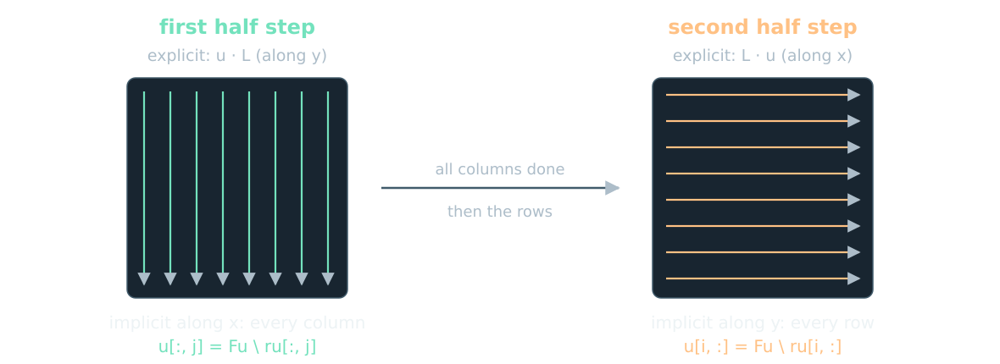{.diagram .full-diagram fig-alt="One ADI time step on the n by n grid of u. First half step: the explicit part u times L couples neighbours along y, then every column is solved with the Cholesky factor, n independent solves. Second half step: the explicit part L times u couples neighbours along x, then every row is solved, again n independent solves."}

::: {.takeaway}
Each half step is n independent solves with the same factor: one Dagger task per column, then per row.
:::

::: {.notes}
Left: the first half step. u·L is the second difference along y, the explicit
part; then each column is a 1D implicit system along x, solved with Fu (and Fv
for v). Right: the second half step swaps the roles, L·u along x explicitly and
row solves along y. The columns of a half step can run at once, on threads,
GPUs or MPI ranks; the next half step needs all of them, because a row crosses
every column.
:::

## The final template's pieces, and why

| Piece | In the template | Why |
|-----------|-----------------------|------------------------------|
| <code>L</code> | periodic 1D Laplacian: <code>-2</code> on the diagonal, <code>1</code> beside it, wrapping at the corners | <code>u * L</code> is the second difference along y, <code>L * u</code> along x. |
| <code>Fu</code>, <code>Fv</code> | <code>cholesky(Symmetric(I - (dt/2) * D * L))</code> | SPD and constant: factor once, reuse in every solve of every step. |
| First half step | <code>ru = u + dt/2 * (Du * (u * L) + …)</code>, then <code>u[:, j] = Fu &#92; ru[:, j]</code> | y explicit, x implicit; the column solves are independent tasks. |
| Second half step | <code>L * u</code> explicit, then <code>u[i, :] = Fu &#92; ru[i, :]</code> | x explicit, y implicit; the row solves are independent tasks. |
| Setup and Use | parameters, fields, <code>simulate!</code> inside <code>Dagger.with_options(scope = …)</code> | Target and Processes choose where the tasks run; the function stays the same. |

::: {.notes}
Walk the template from the top. Attendees fill in L, the two factors and the
two half steps; Setup and Use already sets the parameters and the seeded
fields, calls simulate! where the scope says, and checks that both fields stay
finite. The Visualization panel then draws u and v and replays the run.
:::

## Describe access.<br>Expose parallelism.<br><span class="accent">Measure the result.</span> {.closing}

::: {.subtitle}
One algorithm. A task graph. Room to grow.
:::

::: {.byline}
Continue in <code>exercise/README.md</code> · Reference in <code>solution/my_cholesky.jl</code>
:::

::: {.notes}
End of the deck.
Esc opens the slide overview. S opens speaker notes when served over HTTP.
:::
